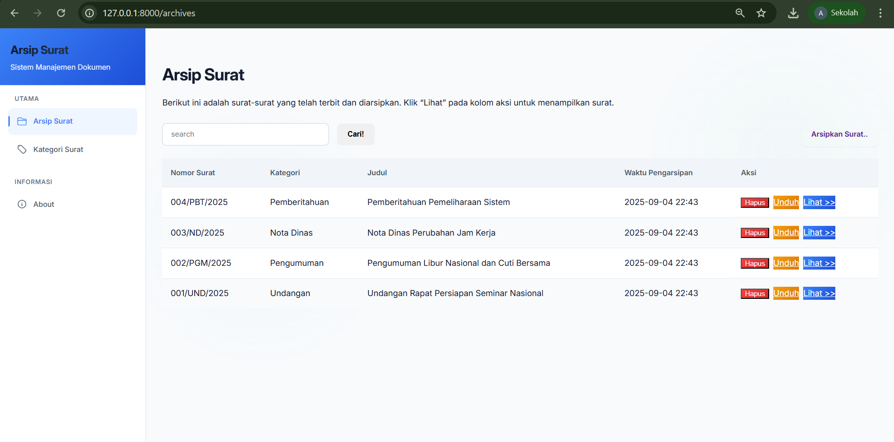
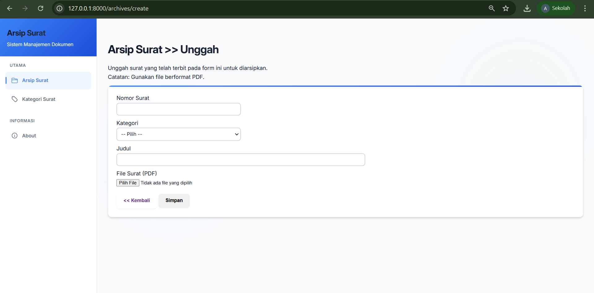
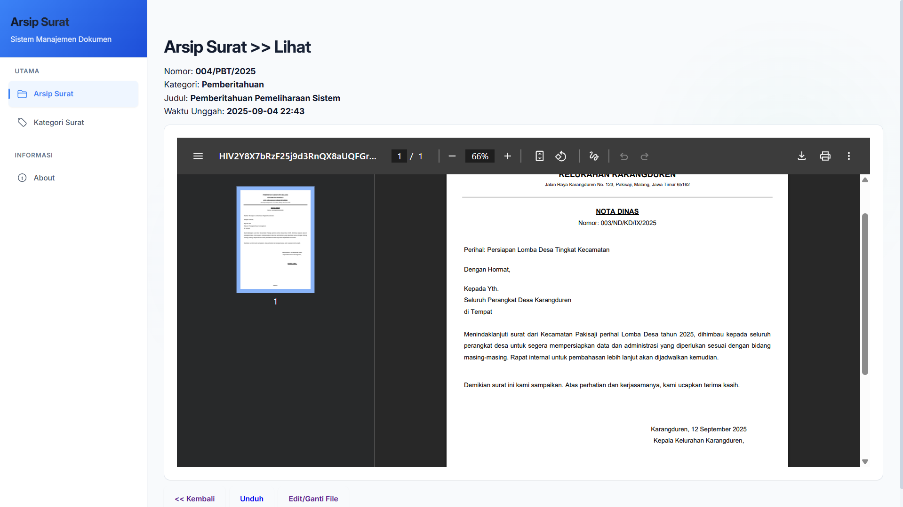
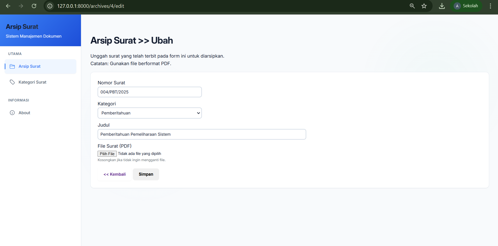
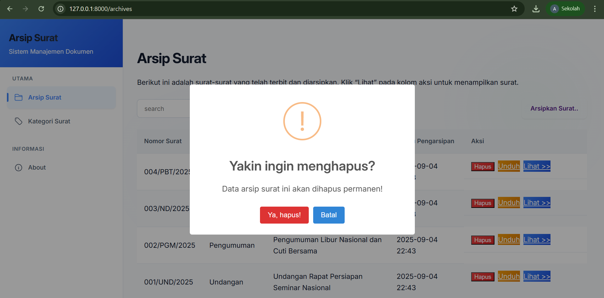
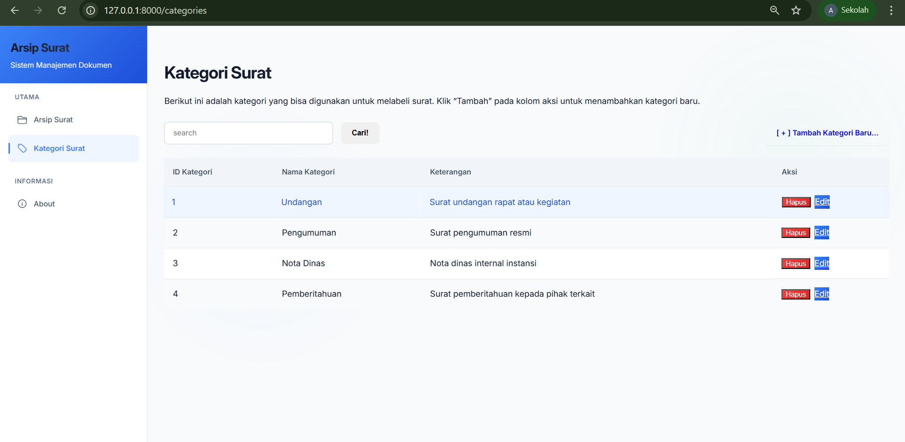
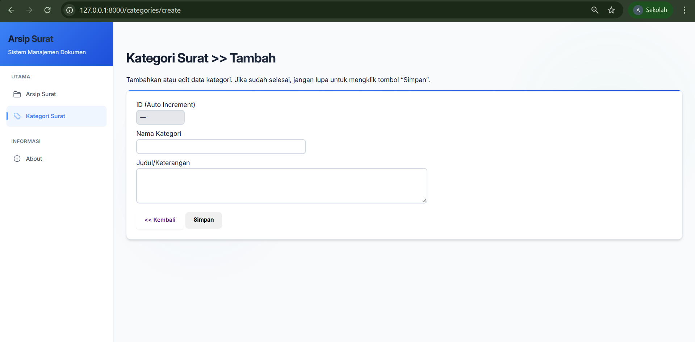
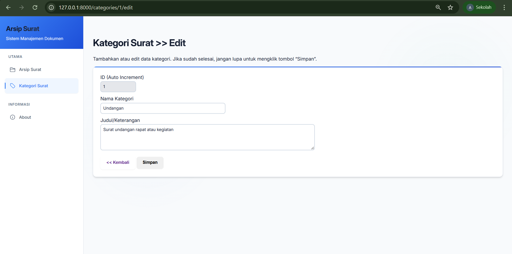
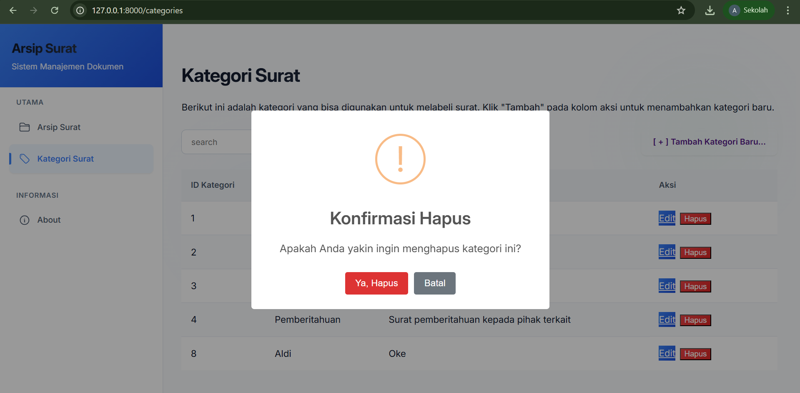
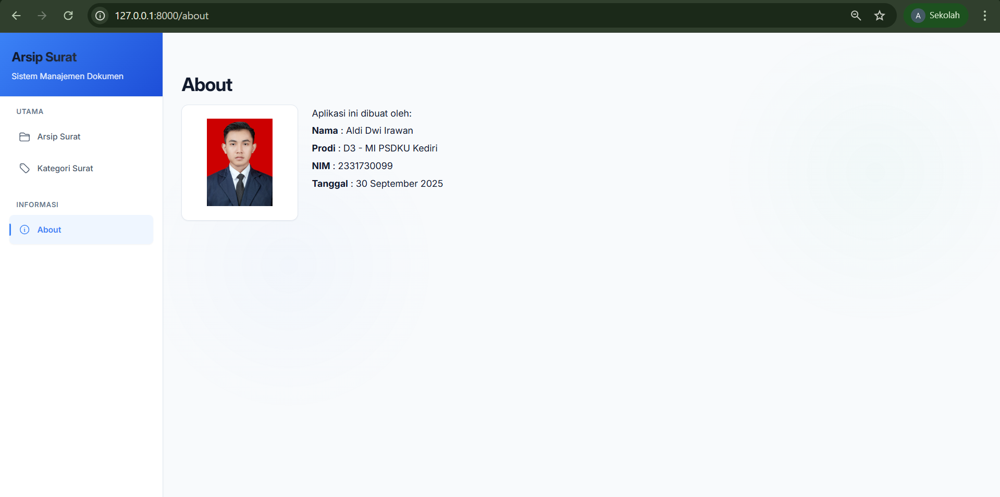

# 📂 SI-Arsip — Digital Letter Archive System


> **SI-Arsip** (Sistem Informasi Arsip Surat) is a web application built with **Laravel 12** for **Karangduren Village** to archive official letters digitally. Staff can upload letters as PDF files, preview them in the browser, organize them by category, and find them quickly by title.

---

## 📌 Project Overview

Village letters were previously archived by hand in folders and shelves, which made them slow to find and easy to misplace. SI-Arsip moves the archive into a computerized system so letters are stored neatly, easy to search, and kept safe — saving the staff time and effort.

---

## 🚀 Key Features

- **Letter archive management** — upload, view, edit, download, and delete letters stored as PDF files (max 5 MB each), with letter number, category, and title.
- **Inline PDF preview** — read a letter directly in the browser without downloading it.
- **Search** — find archived letters by title.
- **Letter categories** — create, edit, and delete categories (e.g. *Undangan*, *Pengumuman*, *Nota Dinas*, *Pemberitahuan*).
- **Delete confirmation** — a confirmation modal before any data is deleted.
- **About page** — shows the developer's identity and the date the app was made.

---

## 🛠️ Technology Stack

| Component | Technology | Purpose |
| :--- | :--- | :--- |
| **Framework** | [Laravel 12](https://laravel.com/) (PHP 8.2) | Web application |
| **Database** | MySQL / MariaDB | Archive and category data |
| **Views** | Blade with custom CSS | User interface |
| **File Storage** | Laravel public disk (`storage/app/public/pdf`) | Uploaded PDF files |

---

## 📁 Project Structure

```text
app/
├── Http/Controllers/
│   ├── ArchiveController.php    # Archive CRUD, search, download
│   └── CategoryController.php   # Category CRUD
└── Models/                      # Archive, Category, User
resources/views/
├── archives/                    # Archive list, upload, detail (PDF preview), edit
├── categories/                  # Category list, create, edit
├── about.blade.php              # About page
└── layouts/app.blade.php        # Main layout
routes/web.php                   # Archive, category, and about routes
aplikasi_arsip.sql               # MySQL database dump (schema + default categories)
screenshot/                      # Application screenshots
```

---

## ⚙️ Installation & Setup

### Prerequisites
- PHP 8.2+ and Composer
- MySQL / MariaDB (for example via Laragon or XAMPP)

### 1. Clone and install
```bash
git clone https://github.com/Aldidwiirawan/aplikasi_arsip_surat.git
cd aplikasi_arsip_surat
composer install
cp .env.example .env
php artisan key:generate
```

### 2. Prepare the database
Create a database named `aplikasi_arsip` and import the dump from the project root:
```bash
mysql -u root -p -e "CREATE DATABASE IF NOT EXISTS aplikasi_arsip CHARACTER SET utf8mb4 COLLATE utf8mb4_unicode_ci;"
mysql -u root -p aplikasi_arsip < aplikasi_arsip.sql
```
The dump creates the `archives` and `categories` tables and adds four default categories: *Undangan*, *Pengumuman*, *Nota Dinas*, and *Pemberitahuan*.

> The Laravel migrations in this repository only create the default framework tables, so importing `aplikasi_arsip.sql` is the required setup step.

### 3. Link the storage folder
```bash
php artisan storage:link
```
Uploaded PDFs are stored in `storage/app/public/pdf` (created automatically on the first upload).

---

## 🔐 Environment Variables

Example values for a default Laragon / XAMPP setup:

```env
APP_NAME="SI-Arsip"
APP_TIMEZONE=Asia/Jakarta

DB_CONNECTION=mysql
DB_HOST=127.0.0.1
DB_PORT=3306
DB_DATABASE=aplikasi_arsip
DB_USERNAME=root
DB_PASSWORD=

FILESYSTEM_DISK=public
SESSION_DRIVER=database
CACHE_STORE=database
QUEUE_CONNECTION=database
```

---

## ▶️ How to Run

```bash
php artisan serve
```
Open `http://127.0.0.1:8000`.

### Quick test
1. Download sample PDF letters from [this Google Drive folder](https://drive.google.com/drive/folders/1RVz1JbeoEF4AQjOu5U-GVtCi4HOdXzec?usp=drive_link).
2. Upload them through the **"Arsipkan Surat..."** menu (keep each file under 5 MB).
3. If the PDF preview does not appear, make sure `php artisan storage:link` has been run and the file is in `storage/app/public/pdf`.

---

## 🖼️ Screenshots

### Archive
| List | Upload |
| :---: | :---: |
|  |  |
| **Detail & PDF preview** | **Edit** |
|  |  |
| **Delete confirmation** | |
|  | |

### Categories
| List | Create |
| :---: | :---: |
|  |  |
| **Edit** | **Delete confirmation** |
|  |  |

### About


---

## 👨‍💻 Author

**Aldi Dwi Irawan** — individual project, built for the LSP Polinema software programming competency assessment
- GitHub: [@Aldidwiirawan](https://github.com/Aldidwiirawan)
- Portfolio: [aldidwiirawan.vercel.app](https://aldidwiirawan.vercel.app)
- Email: aldidwiirawan2004@gmail.com
